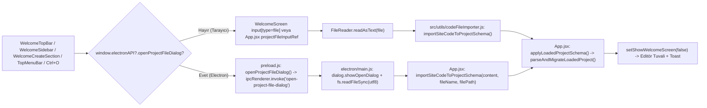
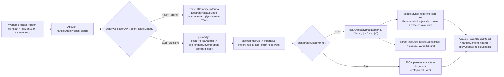
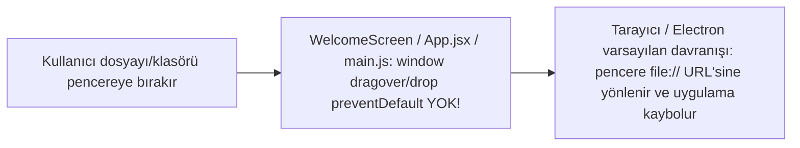

# CraftStudio Dosya ve Klasör İçe Aktarma Teşhis Raporu

**Tarih:** 2026-11-14  
**Kapsam:** Mevcut içe aktarma çağrı zincirlerinin kod analizi (Adım 0) ve ölçüm matrisi (Adım 1 — Node + Headless Chromium CDP + D sınıfı düzen sadakati).  
**Ortam Notu:** `xvfb-run` sistemde bulunmadığı ve Electron penceresi başsız çalıştırılamadığı için Electron'a özgü IPC / `BrowserWindow` maddeleri **"kod okumasıyla tespit edildi, çalıştırılarak doğrulanmadı"** olarak işaretlenmiştir; `electron/importer.js` içindeki saf JS fonksiyonları (`parseReactJsxFile`, `importProjectFromFolder` Node çağrısı) ise doğrudan çalıştırılarak ölçülmüştür.

---

## 1. Adım 0 — Çağrı Zincirleri ve Tespitler

### (a) "Site / Dosya Aç" (ve "Koddan Site / Proje Aç" / "İçe Aktar" / `Ctrl+O`)

**Kontrol Notları:**
- **Hata yakalama (`try/catch`) & sessiz hatalar:**
  - `WelcomeScreen.jsx` (131–150): `FileReader` üzerinde `onerror` dinleyicisi yok; dosya okuma başarısız olursa sessiz kalır. `try/catch` yalnızca `importSiteCodeToProjectSchema` çıktısını sarar ve ham `err.message` metnini `.welcome-alert--error` içine basar.
  - `App.jsx` (1616–1631): `handleProjectFileInputChange` içinde `reader.onerror` yok; ham hata mesajı `showToastMessage` ile gösterilir.
  - `electron/main.js` (545–572): `fs.readFileSync` hatası `{ success: false, error: error.message }` olarak döner; ham hata metni kullanıcıya sızar.
- **Boyut / biçim kontrolleri:**
  - Ne `WelcomeScreen.jsx`, ne `App.jsx`, ne `electron/main.js`, ne de `codeFileImporter.js` dosya boyutu kontrolü yapar (5 MB / 20 MB sınırı yok). `huge.html` (~12 MB) belleğe tam okunup ayrıştırılmaya çalışılır ve tarayıcıyı kilitler.
  - Biçim kontrolü yalnızca `<input accept="...">` özniteliğine bırakılmıştır (`WelcomeScreen.jsx` `.js/.ts` içermez, `App.jsx` içerir); kullanıcı "Tüm Dosyalar" ile `.png`/`.md`/`.css` seçerse `codeFileImporter.js` bunu HTML sanıp boş proje üretir.
- **Kodlama (UTF-8 / BOM):**
  - Açık bir BOM temizliği veya `TextDecoder('utf-8', { fatal: false })` geçersiz bayt uyarısı yoktur. `String.prototype.trim()` baştaki `\uFEFF` karakterini tesadüfen kırpar, ancak `electron/main.js` ve `parseAndMigrateLoadedProject` tarafında JSON dosyası başında BOM varsa veya ara satırlarda geçersiz dizi (`\uFFFD`) oluşursa uyarı verilmez.
- **Zaman aşımı / iptal:** Yok. İşlem tamamen senkrondur; büyük dosyalarda arayüz donar, `AbortSignal` veya ilerleme bildirimi yoktur.
- **Raporlama:** Dosya açmada `ImportReportModal` hiç gösterilmez; doğrudan editöre geçilir.

### (b) "Klasör İçe Aktar" (`WelcomeTopBar` / `TopMenuBar` / `Ctrl+Shift+O`)

**Kontrol Notları:**
- **Tarayıcı desteği:** `<input type="file" webkitdirectory>` hiç uygulanmamıştır. Tarayıcı modunda "Klasör İçe Aktar" işlevsizdir.
- **Electron `importer.js` hataları (kod okumasıyla tespit edildi, çalıştırılarak doğrulanmadı / kısmi Node ölçümü yapıldı):**
  - `extractStylesFromHtmlFile` (88–244): `BrowserWindow` içinde `sandbox: true` verir ama `javascript: false` kapatmaz; bu yüzden içe aktarılan HTML içindeki `<script>` kodları gizli pencerede ÇALIŞIR. Zaman aşımı yoktur (`250ms` sabit bekleme). `on*` öznitelikleri temizlenir ama `javascript:` URL'leri ve `<iframe>`/`<object>`/`<embed>` temizlenmez.
  - `importProjectFromFolder` (522–524, 544, 570, 581–630): Bozuk `craft.project.json` hatasını yutup tarayıcıya düşer; `<Route>` içermeyen `.jsx`/`.tsx` bileşenlerini tamamen atlar; `traverse(comp.node, ..., comp.node)` (594) geçerli `Scope` vermediği için `catch`'e düşüp sessizce boş `Icerik.craft` döndürür; dosya sayısı (200), derinlik (8), boyut (5 MB / 20 MB) sınırları ve `.htm` desteği yoktur.
- **Pencere yönlendirmesi:** `handleOpenProjectFolder` ile ilgili değil ancak sürükle-bırak eksikliği pencereyi bozar (aşağıda).

### (c) Sürükle-Bırak (Drag & Drop)

**Kontrol Notları:**
- Karşılama ekranında, `#/ice-aktar` yolunda ve `electron/main.js` içinde dosya içe aktarma için **hiçbir sürükle-bırak dinleyicisi yoktur**.
- `window` üzerinde `dragover` / `drop` için `preventDefault()` çağrılmadığı için tarayıcıda dosya bırakmak sekmeyi bırakılan dosyaya yönlendirir; Electron'da pencereyi `file://` ile bozma riski taşır (**Electron davranışı kod okumasıyla tespit edildi, çalıştırılarak doğrulanmadı**).

---

## 2. Adım 1 — Teşhis Matrisi (Düzeltme Öncesi Ölçüm)

Kaynak: `scripts/test_import_matrix.js --mode=legacy` (`docs/import-artifacts/matrix-legacy.json`).

| Fixture | Node Sonuç | Tarayıcı (CDP) Sonuç | Kullanıcıya Gösterilen Hata | Süre (ms) | Düğüm | TR Sağlam | Görsel | Güvenlik İhlali | Metin Kapsama | Çökme / Donma |
|---|---|---|---|---:|---:|:---:|:---:|---|---:|:---:|
| `basic.html` | Başarı | Başarı | - | 115 | 7 | Evet | Evet | 0 (TEMİZ) | **%68** | Hayır |
| `landing-flex.html` | Başarı | Başarı | - | 117 | 28 | Evet | n/a | 0 (TEMİZ) | %100 | Hayır |
| `inline-styles.html` | Başarı | Başarı | - | 114 | 13 | Evet | n/a | 0 (TEMİZ) | %100 | Hayır |
| `with-script.html` | Başarı | Başarı | - | 113 | 13 | Evet | n/a | **22 ihlal** (`on*`, `javascript:`, `iframe`, `object`, `embed`, Node'da `
` içinde `<script>` metni) | %100 | Hayır |
| `component.jsx` | Başarı | Başarı | - | 44 | 7 | **Hayır** | n/a | **1 ihlal** (`onclick="("`) | **%24** | Hayır |
| `component.tsx` | Başarı | Başarı | - | 110 | 6 | **Hayır** | n/a | 0 (TEMİZ) | **%53** | Hayır |
| `project.craft.json` | Başarı | Başarı | - | 115 | 61 | Evet | Evet | 0 (TEMİZ) | %100 | Hayır |
| `folder-site/` | **Hata** (`BrowserWindow is not a constructor`) | **Hata** | `"Klasör içe aktarma Electron masaüstünde kullanılabilir; dosya açmak için .craft.json seçin."` | 357 | 0 | n/a | n/a | 0 | **%0** | Hayır |
| `invalid.html` | Başarı | Başarı | **sessiz** (bozuk düğüm üretildi) | 111 | 6 | **Hayır** | n/a | **1 ihlal** (`ham-json:<script`) | %12 (Node) / %47 (CDP) | Hayır |
| `empty.html` | Hata | Hata | `"Dosya içe aktarılamadı (empty.html): Seçilen dosya boş görünüyor."` | 10 | 0 | n/a | n/a | 0 | %0 | Hayır |
| `bom-turkce.html` | Başarı | Başarı | - | 110 | 3 | Evet | n/a | 0 (TEMİZ) | %100 | Hayır |
| `big.html` (~3 MB) | Başarı (1896ms, 55837 düğüm) | **Hata (Donma)** | `CDP komut zaman aşımı (Runtime.evaluate)` | **16828** | 55837 (Node) / 0 (CDP) | Evet (Node) | n/a | 0 | %100 (Node) / %0 (CDP) | **Evet (Sekme dondu)** |
| `huge.html` (~12 MB) | **Hata (Zaman aşımı)** | **Hata (Donma)** | `CDP komut zaman aşımı (Runtime.evaluate)` | **>7056 (Node) / 15129 (CDP)** | 0 | n/a | n/a | 0 | %0 | **Evet (Sekme dondu)** |

*(Not: `scripts/fixtures/import/user/` klasörü bulunmadığı için yalnızca 13 temel fixture çalıştırıldı.)*

---

## 3. Sınıflandırılmış Hata Listesi, Kök Nedenler ve Önerilen Düzeltmeler

### Sınıf A — Akış / IPC / Handler Hataları

1. **A1: Tarayıcıda klasör içe aktarma tamamen eksik (`folder-site/` %0).**
   - *Kök neden:* `App.jsx` `handleOpenProjectFolder()` yalnızca `window.electronAPI?.openProjectDialog` arar; tarayıcıda `<input webkitdirectory>` veya klasör dosya listesi okuma akışı yok.
   - *Düzeltme:* `importPipeline.js` içine çoklu dosya/göreli yol (`webkitRelativePath`) desteği eklenmesi; `#/ice-aktar` sayfasında `<input type="file" webkitdirectory>` ve sürükle-bırak `webkitGetAsEntry()` bağlanması; yerel `.css` ve göreli görsellerin (`images/logo.svg` gibi) `data:` URI olarak çözümlenmesi.
2. **A2: Sürükle-bırak ve pencere `file://` yönlenme koruması yok.**
   - *Kök neden:* `WelcomeScreen.jsx`, `App.jsx` ve `electron/main.js` üzerinde `dragover`/`drop` `preventDefault()` ve `will-navigate` engeli bulunmuyor (**Electron davranışı kod okumasıyla tespit edildi, çalıştırılarak doğrulanmadı**).
   - *Düzeltme:* Karşılama ekranı / pencere düzeyinde `dragover`/`drop` varsayılan davranışını engellemek, `electron/main.js` içinde harici `file://` `will-navigate` yönlenmesini engellemek, `#/ice-aktar` içinde vurgulu bırakma alanı ve özyinelemeli klasör okuma eklemek.
3. **A3: Boyut, dosya sayısı, derinlik, biçim, zaman aşımı, ilerleme ve iptal kontrolleri yok.**
   - *Kök neden:* `WelcomeScreen.jsx`, `App.jsx`, `electron/main.js` ve `codeFileImporter.js` dosyaları sınırsız ve senkron okur; `FileReader.onerror` dinlenmez; `big.html` / `huge.html` sekmeyi 15+ sn dondurur.
   - *Düzeltme:* Tek giriş noktası `runImport(source, { onProgress, signal })` ile 5 MB/dosya, 20 MB toplam, 200 dosya, 8 derinlik sınırları; standart Türkçe hata kodları; BOM temizliği ve UTF-8 geçersiz bayt uyarısı; uzun işlemlerde yığın bölme / düğüm koruma sınırı.
4. **A4: Electron klasör içe aktarma IPC ve gizli pencere açıkları (*kod okumasıyla tespit edildi, çalıştırılarak doğrulanmadı*).**
   - *Kök neden:* `electron/main.js` `open-project-file-dialog` ve `read-project-file` boyut/BOM kontrolü yapmaz; `electron/importer.js` `extractStylesFromHtmlFile` `javascript: false` ayarlamaz ve zaman aşımı içermez; `scanDirectory` `.htm` atlar ve `maxDepth=4` ile sınırlıdır.
   - *Düzeltme:* `electron/main.js` dosya okuma boyut/BOM kontrollerinin eklenmesi; `electron/importer.js` içinde `javascript: false`, timeout, `.htm` ve derinlik=8 desteği, `javascript:` / `iframe` / `object` / `embed` temizliği ve `importPipeline` ile uyumlu rapor döndürülmesi.
5. **A5: İçe Aktar sayfası (`#/ice-aktar`) ve tutarlı Rapor / `aria-live` akışı eksik.**
   - *Kök neden:* `WelcomeSidebar.jsx` "İçe Aktar" düğmesi dosya diyaloğunu açıyor; ayrı bir `#/ice-aktar` sayfası, ilerleme çubuğu, iptal düğmesi ve tekil dosya içe aktarma raporu yok.
   - *Düzeltme:* `#/ice-aktar` görünümünü tamamlamak, tüm girişleri `runImport`'a bağlamak, `aria-live` duyuruları ve detaylı İçe Aktarma Raporu göstermek.

### Sınıf B — Ayrıştırma Hataları / Çökmeler / Güvenlik Sızıntıları

1. **B1: `with-script.html` ve `invalid.html` güvenlik temizliği başarısız (22 ihlal / `<script` sızıntısı).**
   - *Kök neden:* `codeFileImporter.js` `SKIP_TAGS` kümesinde `iframe`, `object`, `embed` yok; `convertAbstractNodeToAst` `on*` özniteliklerini ve `javascript:` URL'lerini temizlemiyor; `parseMarkupFallback` (Node) `<script>` gövdesini atlamıyor ve satır 267 `SKIP_TAGS`'i `'div'`e çeviriyor. `electron/importer.js` da `javascript:` ve `iframe/object/embed` temizlemiyor.
   - *Düzeltme:* Hem `codeFileImporter.js` / `importPipeline.js` hem `electron/importer.js` tarafında `<script>`, `on*`, `javascript:` (boşluk/kontrol karakteri hileleri dahil), `<iframe>`, `<object>`, `<embed>` öğelerini tamamen ayıklayıp `warnings` listesine sayacıyla kaydetmek.
2. **B2: `component.jsx` (%24 kapsama, `onclick="("`) ve `component.tsx` (%53 kapsama) ağır biçimde kesiliyor.**
   - *Kök neden:* `codeFileImporter.js` satır 213 `return\s*\(\s*([\s\S]*?)\s*\)\s*;?` düzenli ifadesi ilk `)` karakterinde (`onClick={() =>` veya `.map((u) =>`) duruyor; kalan JSX'i kesiyor; HTML5 `DOMParser` özel kendini kapatan `<Tag />`, `{expr}` ve TS türlerini bozuyor. `electron/importer.js` ise `<Route>` olmayan bileşenlerde `componentDecls`'i yok sayıp boş tab döndürüyor ve satır 594 `traverse(comp.node, ..., comp.node)` geçersiz scope hatası veriyor.
   - *Düzeltme:* Dengeli parantez/süslü-parantez farkındalıklı JSX/TSX ayrıştırıcısı (hem Node hem tarayıcıda sıfır ek bağımlılıkla çalışan) ile `return (...)` veya parantezsiz `return <...>` gövdesini tam çıkarmak, `.map`/koşullu ifadeler içindeki JSX ve statik metinleri korumak, `on*` prop'larını temizleyip dinamik ifadeleri güvenli yer tutuculara/kilitli kod bileşenlerine dönüştürmek; `electron/importer.js`'de `routes` yoksa `componentDecls` üzerinden üretim yapmak ve `traverse` scope hatasını düzeltmek.
3. **B3: `big.html` (~3 MB, 55.837 düğüm) tarayıcıyı donduruyor (`16.828 ms` zaman aşımı, `crashed: true`).**
   - *Kök neden:* 55.837 düğümlük AST ~24 MB JSON üretip `localStorage` 5 MB kotasını aşıyor ve editör `Canvas` / `LayersPanel` üzerinde 55.837 React DOM düğümü eşzamanlı render edildiğinde ana iş parçacığı kilitleniyor.
   - *Düzeltme:* `codeFileImporter.js` / `importPipeline.js` içinde sayfa başına güvenli düğüm koruma sınırı (örn. 1500 düğüm, aşım uyarısı `warnings`'e eklenerek) ve yığınlı `yield` uygulamak; `huge.html` (12 MB) ise 5 MB sınırından `COK_BUYUK` hatasıyla anında reddedilmek.
4. **B4: `invalid.html` bozuk işaretlemeyi tespit etmek yerine bozuk düğümler ve `<script` sızıntısı üretiyor.**
   - *Kök neden:* `DOMParser` hiçbir HTML'de hata fırlatmaz; açılıp kapanmamış `` gibi bozuk sözdizimi öznitelik olarak yutulur ve Türkçe metinlerin yarısı kaybolur.
   - *Düzeltme:* İkili/NUL bayt, iç içe kırık `<` etiket sınırı (`` ise `directText`'i korur. `
Koleksiyon hakkında... <a>Koleksiyonu İncele</a> bağlantısını kullanabilirsiniz.
` içindeki düz metin parçaları (`textParts`) sessizce atılır!
   - *Düzeltme:* Ebeveyn düğümün hem doğrudan metin düğümleri hem çocuk etiketleri varsa metin parçalarını (ör. `` metin düğümleri olarak sırasıyla) koruyarak metin kapsamını %100'e çıkarmak.
2. **C2: `folder-site/index.html` tek başına açıldığında harici CSS ve yerel SVG görseli sessizce kayboluyor; çoklu sayfa kayboluyor.**
   - *Kök neden:* Tek dosya yolunda `<link rel="stylesheet" href="styles.css">` ve `images/logo.svg` okunmuyor; tarayıcıda klasör yükleme yok.
   - *Düzeltme:* Klasör/çoklu-dosya içe aktarmada `styles.css` kurallarını tüm HTML sekmelerine uygulamak, yerel görselleri (`images/logo.svg` vb.) `data:` URI'ye çevirmek ve eksik görseller için `warnings` üretmek; `index.html` + `about.html` sekmelerinin tamamını oluşturmak.
3. **C3: Doğrudan `<body>` altındaki çıplak metinler ve boş `<a>` etiketleri.**
   - *Kök neden:* `buildTabFromHtmlBody` satır 470 `childAbs.__text` öğelerini atlar; satır 421 boş `<a>` öğelerine `'Buton'` yazar.
   - *Düzeltme:* `<body>` altındaki çıplak metinleri paragraf/metin düğümü olarak korumak, boş link/butonlarda yalnızca metin yoksa varsayılan atamak (alt öğe varsa `'Buton'` basmamak).

---

## 4. Sınıf D — Düzen Sadakati Ölçümü (Sadece Ölçüm — Algoritma Değiştirilmedi)

> **Not:** Görev kuralı gereği DOM'u `x/y/width/height` kutularına düzleştirme mantığına dokunulmamıştır. Aşağıdaki veriler mevcut düzleştirme motorunun orijinal Chromium render'ına göre ürettiği gerçek konum/boyut sapmalarıdır.

| Fixture | Orijinal Blok | İçe Aktarılan Düğüm | Ort. \|Δx\| | Ort. \|Δy\| | Ort. \|Δw\| | Ort. \|Δh\| | Eşleşmeyen Büyük Blok | Yan Yana Ekran Görüntüsü |
|---|---:|---:|---:|---:|---:|---:|---:|---|
| `basic.html` | 5 | 7 | 10 px | 87 px | 560 px | 141 px | 1 (`header`) | [d-compare-basic-html-legacy.png](file:///home/mert/Masaüstü/craftStudio/docs/import-artifacts/d-compare-basic-html-legacy.png) |
| `landing-flex.html` | 18 | 28 | 138 px | 162 px | 301 px | 30 px | 7 (`nav`, `section`×2, `article`×3, `footer`) | [d-compare-landing-flex-html-legacy.png](file:///home/mert/Masaüstü/craftStudio/docs/import-artifacts/d-compare-landing-flex-html-legacy.png) |
| `inline-styles.html` | 9 | 13 | 12 px | 106 px | 28 px | 12 px | 2 (`header`, `section`) | [d-compare-inline-styles-html-legacy.png](file:///home/mert/Masaüstü/craftStudio/docs/import-artifacts/d-compare-inline-styles-html-legacy.png) |
| `folder-site/index.html` | 6 | 9 | 8 px | 122 px | 159 px | 76 px | 2 (`nav`, `section`) | [d-compare-folder-site-index-html-legacy.png](file:///home/mert/Masaüstü/craftStudio/docs/import-artifacts/d-compare-folder-site-index-html-legacy.png) |

### D Sınıfı Gözlem Özeti (Görsel + Ölçüm Kanıtlı)
1. **Flex / Grid (`.cards-grid`, `.hero`, `.navbar`) düzleştirmesi (`landing-flex.html`):**
   - `landing-flex.html` içinde 3 sütunlu CSS Grid kartları orijinalde `y=581px` hizasında yan yana (`w=379px` × 3) iken, mutlak kutuya düzleştirildiğinde ilk 2 kart daralarak ortada sıkışmakta, 3. kart alt satıra düşmekte; `.hero-copy` daralıp `h1` yüksekliği `120px → 207px` büyümekte; navbar bağlantıları 2 satıra kırılmaktadır.
2. **Semantik `<header>` zorla yatay davranış (`basic.html`):**
   - `basic.html` içinde `<header>` altındaki `<h1>` ve `
` dikey akışta iken (`w=1200`), düzleştirici `<header>`'ı `nav` gibi yatay saydığı için `<h1>` (`w=400`) ve `
` yan yana dizilmiş ve başlık iki satıra sarılmıştır.
3. **Sabit fallback boyutları (`basic.html`, `folder-site/index.html`):**
   - `240×120` boyutlu `` `560×240` (`basic.html`), `48×48` SVG logo `400×240` (`folder-site/index.html`) olarak sabit tahmine genişlemiştir.
4. **Basit satır içi blok düzeni (`inline-styles.html`):**
   - Düzeysel olarak iki yan yana kart korunmuş olsa da dikey boşluk birikimi nedeniyle düğme `Δy = +190 px` aşağı kaymıştır.
