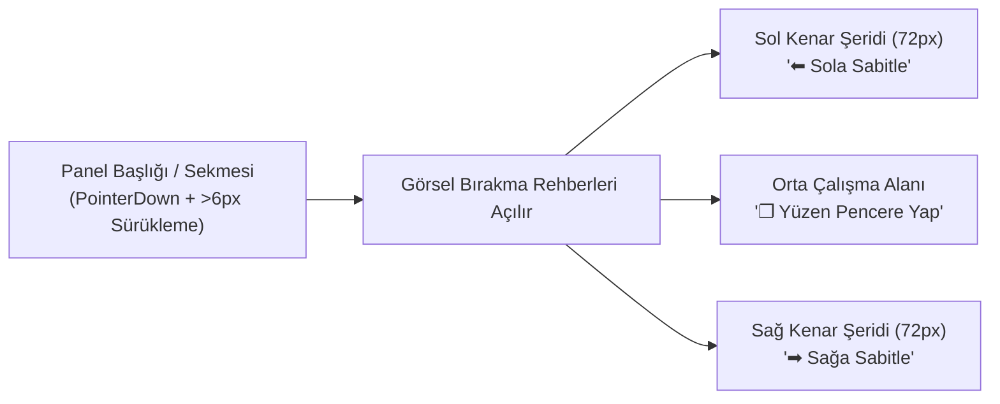

# CraftStudio — Esnek Pencere ve Panel Sistemi Mimari Tasarım Raporu

- **Durum:** Tasarım Aşaması (Kod Yazılmadı — Onay Bekliyor)
- **Dal (Branch):** `feat/window-system`
- **Hedef Kullanıcı:** Kod bilmeyen (no-code) kullanıcılar için sürükle-bırak, görsel bırakma rehberleri (drop zones) ve tek tıkla konum değiştirme (`Sol`, `Sağ`, `Yüzen`) ile çalışan sezgisel pencere/panel sistemi.
- **Kapsam Dışı (Dokunulmayacak):** `src/components/WelcomeScreen.jsx`, `src/components/welcome/*`, `src/proto/*`.
- **Temel Koruma İlkesi:** Varsayılan ("Standart") düzende **Tasarım modunun mevcut görünümü, DOM yapısı ve davranışı BİREBİR aynı kalacaktır**.

---

## 1. Mevcut Durum Analizi (Kod Tabanı Envanteri)

Mevcut kod tabanındaki 7 ilgili modül ([StudioLeftSidebar.jsx](file:///home/mert/Masaüstü/craftStudio/src/components/StudioLeftSidebar.jsx), [StudioRightDock.jsx](file:///home/mert/Masaüstü/craftStudio/src/components/StudioRightDock.jsx), [AttributesCssInspectorModal.jsx](file:///home/mert/Masaüstü/craftStudio/src/components/AttributesCssInspectorModal.jsx), [FloatingAIChatDock.jsx](file:///home/mert/Masaüstü/craftStudio/src/components/FloatingAIChatDock.jsx), [TopMenuBar.jsx](file:///home/mert/Masaüstü/craftStudio/src/components/TopMenuBar.jsx), [useWorkspaceLayout.js](file:///home/mert/Masaüstü/craftStudio/src/hooks/useWorkspaceLayout.js), [studioModesRegistry.js](file:///home/mert/Masaüstü/craftStudio/src/data/studioModesRegistry.js)) incelenerek çıkarılan mevcut panel envanteri aşağıdadır:

### 1.1 Mevcut Paneller ve Yetenek Tablosu

| Panel / Bileşen | Mevcut Konumu | Sabit (Docked) Olabilir mi? | Yüzen (Floating) Olabilir mi? | Yeniden Boyutlandırılabilir mi? | Küçültülebilir / Kapatılabilir mi? | Durumun Tutulduğu Yer |
| :--- | :--- | :---: | :---: | :---: | :---: | :--- |
| **Sol Çekmeceler (Tasarım):**<br>`layers` (Katmanlar),<br>`templates` (Şablonlar & Bloklar),<br>`elements` (HTML Etiketleri),<br>`code` (Canlı Kod),<br>`ai` (Sol Gemini AI Sohbet) | Sol araç rayının (`52px`) hemen sağında ([StudioLeftSidebar.jsx](file:///home/mert/Masaüstü/craftStudio/src/components/StudioLeftSidebar.jsx#L1091-L1441)) | Evet *(yalnızca sol kenar)* | **Hayır** | Evet (`220px` – `440px`, varsayılan `248px`, `ai` için min `296px`) — *ancak genişlik `StudioLeftSidebar` içinde lokal `useState` olarak tutuluyor* | Evet (`setActiveTab(null)` ile tamamen kapanır) | `activeTab`: `useWorkspaceLayout` (`layoutsByMode.design.leftDrawer.activeTab`)<br>`drawerWidth`: `StudioLeftSidebar` lokal state |
| **Sol Çekmeceler (Backend):**<br>`flows` (İş Akışları),<br>`dataModels` (Veri Kutuları),<br>`triggers` (Tetikleyiciler),<br>`ai` (Sol Gemini AI Sohbet) | Sol araç rayının (`52px`) hemen sağında ([StudioLeftSidebar.jsx](file:///home/mert/Masaüstü/craftStudio/src/components/StudioLeftSidebar.jsx#L613-L663)) | Evet *(yalnızca sol kenar)* | **Hayır** | **Kısmen** (`drawerWidth` state'ini okuyor ancak Backend dalında sağ kenar resize tutamacı render edilmiyor) | Evet (`setActiveTab(null)`) | `activeTab`: `useWorkspaceLayout` (`layoutsByMode.backend.leftDrawer.activeTab`) |
| **Sağ Özellikler Dock'u (Tasarım):**<br>`PropertiesPanel` (`block`, `style`, `layout`, `props`, `css`, `code` sekmeleri) | Sağ dikey ikon rayının (`40px`) hemen solunda ([StudioRightDock.jsx](file:///home/mert/Masaüstü/craftStudio/src/components/StudioRightDock.jsx#L100-L190)) | Evet *(yalnızca sağ kenar)* | **Hayır** *(yalnızca CSS/Nitelik için ayrı bir modal açabiliyor)* | Evet (`296px` – `540px` veya `window.innerWidth * 0.48`, varsayılan `336px`, çift tıkla sıfırlama) | Evet (`isOpen: false` olunca `40px` ikon rayına daralır) | `useWorkspaceLayout` (`layoutsByMode.design.rightDock: { isOpen, propertiesTab, width }`) |
| **Sağ Özellikler Dock'u (Backend):**<br>`stepConfig`, `dataBinding`, `testRun` sekmeleri | Sağ dikey ikon rayının (`40px`) hemen solunda ([StudioRightDock.jsx](file:///home/mert/Masaüstü/craftStudio/src/components/StudioRightDock.jsx#L162-L185)) | Evet *(yalnızca sağ kenar)* | **Hayır** | Evet (`296px` – `540px`, varsayılan `336px`) | Evet (`isOpen: false`) | `useWorkspaceLayout` (`layoutsByMode.backend.rightDock`) |
| **Yüzen CSS & Nitelik Penceresi:**<br>`AttributesCssInspectorModal` (`css`, `attrs`, `raw_css` sekmeleri) | Tuval üzerinde `fixed` yüzen katman ([AttributesCssInspectorModal.jsx](file:///home/mert/Masaüstü/craftStudio/src/components/AttributesCssInspectorModal.jsx#L55-L70)) | **Dolaylı** (*"Panele Sabitle"* butonu pencereyi kapatıp sağ dock'ta `css`/`props`/`code` sekmesini açar) | Evet (`x, y` sürüklenebilir, `clampFloatingRect` korumalı) | Evet (sağ-alt köşeden `minWidth: 440`, `minHeight: 360`, varsayılan `760×560`) | Kapatılabilir (`X` veya `Esc`); başlığa küçültme (minimize) **yok** | Açık/kapalı: `layout.modals.attributesInspector`<br>Geometri (`floatingRect`): bileşen içi lokal `useState` |
| **Yüzen AI Sohbet Kutusu:**<br>`FloatingAIChatDock` | Orta çalışma alanının alt-ortasında sabit (`absolute inset-x-0 bottom-8 z-30`, `max-w-[620px]`) ([FloatingAIChatDock.jsx](file:///home/mert/Masaüstü/craftStudio/src/components/FloatingAIChatDock.jsx#L54-L77)) | **Dolaylı** (*"Tam Sohbet"* butonu sol çekmecede `'ai'` sekmesini açar) | Yalnızca alt-ortada sabit; serbest sürüklenemez | **Hayır** (`max-w-[620px]` sabit) | Evet (`isMinimized: true` olunca `"Gemini ile Tasarla"` hap butonuna küçülür) | `useWorkspaceLayout` (`layout.aiDock: { isMinimized, focusSignal }`) |

### 1.2 Mevcut Mimari Kısıtlar
1. **Aynı anda yalnızca 1 sol panel açılabiliyor:** `leftDrawer.activeTab` tek bir string (`'layers'` veya `'templates'`) tuttuğu için kullanıcı aynı anda hem **Katmanlar**'ı hem **Şablonlar & Bloklar**'ı açık tutamıyor; birini açınca diğeri kapanıyor.
2. **Paneller kenar değiştiremiyor veya yüzen yapılamıyor:** Kullanıcı `Katmanlar` panelini sağa alamıyor veya `Şablonlar` panelini tuval üzerinde yüzen bir palet olarak ayıramıyor.
3. **Sol çekmece genişliği merkezi state'te değil:** `StudioLeftSidebar` içindeki `drawerWidth` lokal state olduğu için:
   - Uygulama yenilendiğinde veya mod değişip bileşen dalı değiştiğinde genişlik korunmuyor.
   - [useCanvasView.js](file:///home/mert/Masaüstü/craftStudio/src/hooks/useCanvasView.js#L42) gerçek sol çekmece genişliğini bilmediği için `leftSidebarTab === 'ai' ? 340 : 292` sabit tahmini yapıyor.
4. **Yüzen CSS penceresi gerçek bir panel yuvası değil, `modals` altında tutuluyor:** `layout.modals.attributesInspector` açıkken [useShortcuts.js](file:///home/mert/Masaüstü/craftStudio/src/hooks/useShortcuts.js#L81) `isAnyModalOpen = true` kabul ettiği için, kullanıcı arka plandaki tuvale tıklayabilse bile tuval klavye kısayolları (`V`, `R`, `Delete`, `Ctrl+Z`) devre dışı kalıyor. Ayrıca seçili eleman yokken (`!element`) pencere tamamen kayboluyor.
5. **Uygulama yeniden açıldığında düzen hatırlanmıyor:** `useWorkspaceLayout` her açılışta `createInitialWorkspaceLayout()` ile bellekte sıfırdan başlıyor; kullanıcının ayarladığı panel genişlikleri veya açık bıraktığı paneller `localStorage` (`settingsStore`) üzerinde saklanmıyor.

---

## 2. Hedef Model: Birleşik Panel Kayıt Defteri (`PANEL_REGISTRY`) ve Bölgeler (Zones)

### 2.1 Konum Bölgeleri (Zones) Değerlendirmesi

Kod bilmeyen bir kullanıcı için pencere sistemi görsel olarak karmaşık bir IDE'ye (VS Code / Eclipse gibi 10'lu bölünmüş ızgaralara) dönüşmemeli; Adobe / Figma / Canva sadeliğinde kalmalıdır:

1. **`left` (Sol Dock Bölgesi):** Sol araç rayının (`52px`) hemen sağındaki dikey kenar yuvası.
2. **`right` (Sağ Dock Bölgesi):** Sağ dikey ikon rayının (`40px`) hemen solundaki dikey kenar yuvası.
3. **`floating` (Yüzen Pencere Katmanı):** Orta çalışma alanının üzerinde serbestçe sürüklenebilen, boyutlandırılabilen, başlık çubuğuna küçültülebilen (minimize/shade) ve ekran dışına taşması `clampFloatingRect` ile engellenen pencere katmanı.
4. **`bottomCenter` (Alt-Orta Yüzen Komut Yuvası — Yalnızca `aiPromptBar` için):** Mevcut `FloatingAIChatDock` bileşeninin varsayılan zarif alt-orta konumu.

> [!NOTE]
> **Alt (`bottom`) ve Üst (`top`) Kenar Dock Bölgeleri Gerekir mi? (Öneri & Gerekçe)**
> - **Üst (`top`) Dock ÖNERİLMEZ:** Üstte zaten `TopMenuBar` (`40px` komut çubuğu + `36px` sayfa sekmeleri) ve tuval içi breadcrumb/cihaz bilgi şeridi yer almaktadır. Üste yatay bir panel sabitlemek dikey çalışma alanını aşırı daraltır.
> - **Alt (`bottom`) Dock:**
>   - **Tasarım modunda ÖNERİLMEZ:** Alt-ortada `FloatingAIChatDock` ve tuvalin altında `"Sayfa Boyunu Uzat"` tutamacı bulunmaktadır; yatay şekilli hiçbir tasarım paneli yoktur (`Katmanlar`, `Bloklar`, `Özellikler` tamamı dikey listelerdir).
>   - **Backend modunda İLERİDE OPSİYONEL:** Görsel akış tuvali geldiğinde `"Test & Çıktı Günlüğü (testRun)"` veya `"Veri Tablosu Önizleme"` için yatay bir alt çekmece yararlı olabilir.
> - **Karar Önerisi:** Veri modelindeki `zone` alanı genişletilebilir bir string enum (`'left' | 'right' | 'floating'`) olarak tasarlanmalı; ilk sürümde yalnızca **`left`, `right` ve `floating`** aktif edilmelidir (bkz. **Bölüm 11, Açık Soru 1**).

### 2.2 Panel Kayıt Şeması (`PANEL_REGISTRY`)

`src/data/studioModesRegistry.js` ile uyumlu olarak her panel aşağıdaki standart şema ile tanımlanır:

```js
/**
 * src/data/panelRegistry.js (veya studioModesRegistry.js içinde birleşik)
 */
export const PANEL_REGISTRY = {
  // --- TASARIM MODU PANELLERİ ---
  layers: {
    id: 'layers',
    title: 'Katmanlar',
    menuLabel: 'Katmanlar (Layers)',
    icon: 'Layers',
    modes: ['design'],
    defaultZone: 'left',
    allowedZones: ['left', 'right', 'floating'],
    defaultOpen: false, // Varsayılan Standart düzende kapalı (mevcut davranışla birebir aynı)
    canFloat: true,
    canMinimize: true,
    canClose: true,
    shortcutHint: 'Alt+L',
    sizeLimits: {
      minWidth: 220,
      maxWidth: 440,
      defaultWidth: 248,
      minHeight: 280,
      maxHeight: 820,
      defaultHeight: 480,
    },
  },
  templates: {
    id: 'templates',
    title: 'Şablonlar & Bloklar',
    menuLabel: 'Assetler & Şablonlar',
    icon: 'Box',
    modes: ['design'],
    defaultZone: 'left',
    allowedZones: ['left', 'right', 'floating'],
    defaultOpen: false,
    canFloat: true,
    canMinimize: true,
    canClose: true,
    shortcutHint: 'Alt+A',
    sizeLimits: {
      minWidth: 240,
      maxWidth: 460,
      defaultWidth: 264,
      minHeight: 320,
      maxHeight: 840,
      defaultHeight: 520,
    },
  },
  elements: {
    id: 'elements',
    title: 'HTML Etiketleri',
    menuLabel: 'HTML Etiketleri',
    icon: 'Tag',
    modes: ['design'],
    defaultZone: 'left',
    allowedZones: ['left', 'right', 'floating'],
    defaultOpen: false,
    canFloat: true,
    canMinimize: true,
    canClose: true,
    shortcutHint: null,
    sizeLimits: {
      minWidth: 220,
      maxWidth: 420,
      defaultWidth: 248,
      minHeight: 280,
      maxHeight: 760,
      defaultHeight: 460,
    },
  },
  properties: {
    id: 'properties',
    title: 'Özellikler & Tasarım',
    menuLabel: 'Özellikler & Hizalama',
    icon: 'Sliders',
    modes: ['design'],
    defaultZone: 'right',
    allowedZones: ['right', 'left', 'floating'],
    defaultOpen: true, // Varsayılan Standart düzende sağda açık (336px)
    defaultSubTab: 'layout', // 'block' | 'style' | 'layout' | 'props' | 'css' | 'code'
    canFloat: true,
    canMinimize: true,
    canClose: true,
    shortcutHint: 'Alt+P',
    sizeLimits: {
      minWidth: 296,
      maxWidth: 540,
      defaultWidth: 336,
      minHeight: 360,
      maxHeight: 880,
      defaultHeight: 600,
    },
  },
  attributesAndCss: {
    id: 'attributesAndCss',
    title: 'CSS & Nitelik Penceresi',
    menuLabel: 'Yüzen CSS & Nitelik Penceresi',
    icon: 'Tag',
    modes: ['design'],
    defaultZone: 'floating',
    allowedZones: ['floating', 'right', 'left'],
    defaultOpen: false,
    dividerBeforeInMenu: true,
    canFloat: true,
    canMinimize: true,
    canClose: true,
    shortcutHint: 'Alt+C',
    sizeLimits: {
      minWidth: 440,
      maxWidth: 960,
      defaultWidth: 760,
      minHeight: 360,
      maxHeight: 860,
      defaultHeight: 560,
    },
  },

  // --- EVRENSEL AI PANELLERİ (HER İKİ MODDA) ---
  aiHistory: {
    id: 'ai',
    title: 'Gemini AI Sohbet & Geçmiş',
    menuLabel: 'AI Tam Sohbet Paneli',
    icon: 'Sparkles',
    modes: ['design', 'backend'],
    defaultZone: 'left',
    allowedZones: ['left', 'right', 'floating'],
    defaultOpen: false,
    canFloat: true,
    canMinimize: true,
    canClose: true,
    shortcutHint: null,
    sizeLimits: {
      minWidth: 296,
      maxWidth: 480,
      defaultWidth: 312,
      minHeight: 360,
      maxHeight: 840,
      defaultHeight: 540,
    },
  },
  aiAgent: {
    id: 'aiAgent',
    title: 'AI Sohbet Çubuğu',
    menuLabel: 'AI Sohbet Çubuğu',
    icon: 'Sparkles',
    modes: ['design', 'backend'],
    defaultZone: 'bottomCenter',
    allowedZones: ['bottomCenter'],
    defaultOpen: true, // isMinimized === false
    canFloat: false,
    canMinimize: true,
    canClose: true,
    shortcutHint: 'Ctrl+K',
    sizeLimits: { minWidth: 320, maxWidth: 620, defaultWidth: 620 },
  },

  // --- BACKEND MODU PANELLERİ ---
  flows: {
    id: 'flows',
    title: 'Olay & İş Akışları',
    menuLabel: 'İş Akışları (Flows)',
    icon: 'Workflow',
    modes: ['backend'],
    defaultZone: 'left',
    allowedZones: ['left', 'right', 'floating'],
    defaultOpen: true, // Backend modunda varsayılan açık sol panel
    canFloat: true,
    canMinimize: true,
    canClose: true,
    shortcutHint: null,
    sizeLimits: {
      minWidth: 220,
      maxWidth: 440,
      defaultWidth: 256,
      minHeight: 280,
      maxHeight: 800,
      defaultHeight: 480,
    },
  },
  dataModels: {
    id: 'dataModels',
    title: 'Veri Kutuları & Tablolar',
    menuLabel: 'Veri Kutuları',
    icon: 'Database',
    modes: ['backend'],
    defaultZone: 'left',
    allowedZones: ['left', 'right', 'floating'],
    defaultOpen: false,
    canFloat: true,
    canMinimize: true,
    canClose: true,
    shortcutHint: null,
    sizeLimits: {
      minWidth: 220,
      maxWidth: 440,
      defaultWidth: 256,
      minHeight: 280,
      maxHeight: 800,
      defaultHeight: 480,
    },
  },
  triggers: {
    id: 'triggers',
    title: 'Sayfa Tetikleyicileri',
    menuLabel: 'Tetikleyiciler',
    icon: 'Zap',
    modes: ['backend'],
    defaultZone: 'left',
    allowedZones: ['left', 'right', 'floating'],
    defaultOpen: false,
    canFloat: true,
    canMinimize: true,
    canClose: true,
    shortcutHint: null,
    sizeLimits: {
      minWidth: 220,
      maxWidth: 440,
      defaultWidth: 256,
      minHeight: 280,
      maxHeight: 800,
      defaultHeight: 480,
    },
  },
  backendInspector: {
    id: 'backendInspector',
    title: 'Akış & Veri Özellikleri',
    menuLabel: 'Akış & Adım Özellikleri',
    icon: 'Sliders',
    modes: ['backend'],
    defaultZone: 'right',
    allowedZones: ['right', 'left', 'floating'],
    defaultOpen: true,
    defaultSubTab: 'stepConfig', // 'stepConfig' | 'dataBinding' | 'testRun'
    canFloat: true,
    canMinimize: true,
    canClose: true,
    shortcutHint: null,
    sizeLimits: {
      minWidth: 296,
      maxWidth: 540,
      defaultWidth: 336,
      minHeight: 340,
      maxHeight: 840,
      defaultHeight: 540,
    },
  },
};
```

---

## 3. Etkileşim ve Pencere Davranışları

### 3.1 Aynı Anda Birden Çok Panelin Açılması
1. **Farklı Bölgelerde Eşzamanlı Açıklık:**
   - Kullanıcı aynı anda **Sol Dock'ta** `Katmanlar`, **Sağ Dock'ta** `Özellikler & Tasarım` ve **Yüzen Katmanda** `Şablonlar & Bloklar` (veya `CSS & Nitelik Penceresi`) panellerini açık tutabilir.
2. **Aynı Kenar Dock Bölgesinde Birden Çok Panel (Sekmeli Gruplama vs. Dikey Bölme):**
   - Bir kenarda (`left` veya `right`) yan yana iki sütun (`248px + 264px = 512px`) açmak dizüstü ekranlarda orta tuvali kullanılamaz hale getirir. Bu nedenle her kenar dock bölgesi **tek bir sütun genişliğine (`leftDock.width` / `rightDock.width`)** sahiptir.
   - Aynı kenara birden fazla panel sabitlendiğinde:
     - **Varsayılan Davranış (Sekmeli Dock Grubu — Tabbed Group):** Kenar çekmecesinin en üstünde kompakt bir **Panel Sekme Şeridi** (`[ 📑 Katmanlar × ] [ 📦 Şablonlar × ]`) görünür. Kullanıcı sekmelere tıklayarak aynı kenardaki açık paneller arasında anında geçiş yapar veya sekmeyi tutup orta alana sürükleyerek yüzen pencere olarak ayırır.
     - **Opsiyonel Dikey Bölme (Üst / Alt Split — bkz. Bölüm 11, Açık Soru 2):** Kullanıcı aynı kenarda iki paneli aynı anda görmek isterse (ör. solda üstte `Katmanlar`, altta `Şablonlar`), paneli sol kenarın alt yarısına sürüklediğinde tek sütun dikey olarak ikiye bölünebilir (`50% / 50%`, ortada yatay splitter ile).

### 3.2 Sürükle-Bırak ve Görsel İpuçları (Kod Bilmeyen Kullanıcı Deneyimi)
Kod bilmeyen kullanıcılar karmaşık dock ikonlarını çözmek zorunda kalmamalıdır; hem **sürükle-bırak rehberleri** hem de **tek tıkla konum menüsü** sunulur:



1. **Sürükleme Başlangıcı:** Kullanıcı herhangi bir sabit veya yüzen panelin başlık çubuğundaki tutamaçtan (`GripHorizontal`) tutup `6px`'ten fazla sürüklediğinde:
   - Ekranın sol kenarında (`left: 52px, width: 88px`) ve sağ kenarında (`right: 40px, width: 88px`) yarı saydam mavi/zümrüt **Bırakma Rehberi (Drop Target Overlay)** belirir.
   - İmleç sol rehberin üzerindeyken `"⬅ Sol Panele Sabitle"`, sağ rehberin üzerindeyken `"➡ Sağ Panele Sabitle"`, orta alandayken `"❐ Yüzen Pencere Olarak Bırak"` rozeti gösterilir.
2. **Sürüklemeden Tek Tıkla Taşıma:**
   - Her panelin başlık çubuğunun sağ üst köşesinde `Konum` ikonu / butonları yer alır:
     - Sabit paneldeyken: `[ ❐ Yüzen Yap ]` (`ExternalLink`) ve `[ ⇄ Karşı Kenara Al ]`.
     - Yüzen penceredeyken: `[ ⬅ Sola Sabitle ]`, `[ ➡ Sağa Sabitle ]`, `[ − Küçült ]`, `[ × Kapat ]`.

### 3.3 Sabitleme / Çıkarma (Dock / Undock), Boyutlandırma, Küçültme ve Kapatma
- **Yüzen Pencereye Çıkarma (Undock):**
  - Sabit bir panel yüzen yapıldığında (`movePanelToZone(panelId, 'floating')`), bulunduğu dock sekme grubundan çıkar; eğer o kenarda başka açık panel kalmadıysa kenar çekmecesi otomatik kapanır.
  - Yüzen pencere son bilinen `floatingRect` konumunda (yoksa tuvalin sağ-üst güvenli koordinatında, açık diğer yüzen pencerelerle üst üste binmeyecek şekilde `+24px` kademeli ofsetle) açılır ve en üst `zIndex`'e (`bringPanelToFront(panelId)`) gelir.
- **Kenara Sabitleme (Dock):**
  - Yüzen bir pencere `left` veya `right` bölgesine sabitlendiğinde (`movePanelToZone(panelId, 'left' | 'right')`), yüzen katmandan kalkar, hedef kenar çekmecesini açar (`isOpen: true`) ve o kenarın aktif paneli olur.
  - **Özel Durum (`attributesAndCss`):** Seçili eleman yokken bile yüzen veya sabit olarak açılabilir; eleman seçili değilse içeride `"CSS ve HTML özniteliklerini düzenlemek için tuvalden bir öğe seçin"` boş durum mesajı gösterilir (böylece pencere seçim kaldırıldığında aniden kaybolmaz!).
- **Boyutlandırma (Resize):**
  - **Sol Dock:** Sağ kenarındaki `w-2 cursor-col-resize` splitter ile `220px – 440px` arasında boyutlandırılır; çift tıklama `248px` varsayılanına sıfırlar. Genişlik artık `layoutsByMode[mode].leftDock.width` içinde merkezi olarak tutulur.
  - **Sağ Dock:** Sol kenarındaki splitter ile `296px – 540px` arasında boyutlandırılır; çift tıklama `336px` varsayılanına sıfırlar.
  - **Yüzen Pencereler:** Sağ, alt ve sağ-alt köşe tutamaçlarından panelin `sizeLimits` (`minWidth`, `minHeight`, `maxWidth`, `maxHeight`) sınırları içinde boyutlandırılır.
- **Küçültme (Minimize / Window Shade):**
  - **Sabit Kenar Dock'u:** Başlıktaki `ChevronsLeft` / `ChevronsRight` butonuyla daraltıldığında çekmece kapanır, yanındaki dikey ikon rayında simgesi kalır.
  - **Yüzen Pencere:** Başlıktaki `−` (Küçült) butonuna (veya başlık çubuğuna çift tıklamaya) basıldığında pencere gövdesi gizlenir ve yalnızca `36px` yüksekliğinde kompakt başlık çubuğuna katlanır (`isMinimized: true`); tekrar tıklanınca önceki `height` değerine açılır.
- **Kapatma (`×`):**
  - Paneli `isOpen: false` yapar, ancak panelin hangi bölgede (`zone`) olduğu ve son `floatingRect` boyutu unutulmaz. `Pencere` menüsünden tekrar açıldığında kaldığı bölgede ve boyutta açılır.

### 3.4 Ekrana Sığmama ve Küçük Ekran (`< 1280px`) Koruması
1. **Minimum Orta Tuval Alanı Garantisi (`MIN_CENTER_WORKSPACE_WIDTH = 380`):**
   - Sol ray (`52px`) + Sağ ray (`40px`) + `leftDock.width` + `rightDock.width` toplamı her zaman `window.innerWidth - 380` sınırına göre sıkıştırılır (`clampDockWidthsToViewport`).
   - Kullanıcı pencereyi daralttığında önce açık olan dock'ların efektif genişliği kendi `minWidth` sınırlarına kadar daralır.
   - Pencere çok küçülürse (`window.innerWidth < 940px`) ve hem sol hem sağ dock aynı anda açıksa, en son açılmayan (daha eski) kenar çekmecesi otomatik daraltılarak orta tuvalin ezilmesi önlenir.
2. **Yüzen Pencere Sınır Koruması (`clampFloatingRect`):**
   - Mevcut [propertySearch.js](file:///home/mert/Masaüstü/craftStudio/src/utils/propertySearch.js#L159-L179) içindeki `clampFloatingRect` fonksiyonu tüm yüzen paneller için ortak kullanılır.
   - Üst sınır `y >= 44` (`TopMenuBar` komut çubuğunun üstünü asla kapatamaz) ve ekran küçüldüğünde pencerenin `width`/`height` değerleri `window.innerWidth - 32` / `window.innerHeight - 64` içine otomatik kırpılır.

---

## 4. Düzen Kaydı, Sıfırlama, Hazır Düzenler ve Proje vs. Kullanıcı Ayarı

### 4.1 Düzen Proje Dosyasına (`.craft.json`) mı Yoksa Kullanıcı Ayarına (`settingsStore`) mı Ait?

> [!IMPORTANT]
> **Öneri: Pencere ve panel düzeni KULLANICI AYARINA ([src/settings/settingsStore.js](file:///home/mert/Masaüstü/craftStudio/src/settings/settingsStore.js) — `craftstudio_settings_v1`) aittir; `.craft.json` proje dosyasına KAYDEDİLMEMELİDİR.**

**Gerekçeler:**
1. **Cihaz ve Çözünürlük Bağımsızlığı:** `.craft.json` proje dosyası `2560×1440` masaüstü ekranda kaydedilip `1366×768` dizüstü bilgisayarda (veya başka bir kullanıcı tarafından) açıldığında, büyük ekrana göre ayarlanmış panel genişlikleri ve yüzen pencere koordinatları küçük ekranı bozar.
2. **Proje Kirli (`hasUnsavedChanges`) Bayrağı İzolasyonu:** Kullanıcının `Katmanlar` panelini açması, kapatması veya sağ paneli `30px` genişletmesi **proje tasarım verisini değiştirmemektedir**. Düzen `.craft.json` içinde tutulursa her panel açılışında `● Kaydedilmedi` rozeti yanar ve gereksiz otomatik taslak (`autosaveDraft`) yazılır.
3. **Mimari Tutarlılık:** Onaylanan Mod Sistemi tasarımında (`docs/mod-sistemi-tasarim.md` Karar 1) `activeMode` proje dosyasına kaydedilmeyip çalışma ortamı durumu kabul edilmiştir. Aynı ilkeyle `layoutsByMode` da kullanıcı çalışma ortamı ayarıdır.
4. **Mevcut `settingsStore.js` Altyapısıyla Doğrudan Uyum:** [src/settings/settingsStore.js](file:///home/mert/Masaüstü/craftStudio/src/settings/settingsStore.js#L17-L23) zaten `craftstudio_settings_v1` anahtarını, `migrateSettings(raw)` şema göçünü ve [SettingsDataTab.jsx](file:///home/mert/Masaüstü/craftStudio/src/components/settings/SettingsDataTab.jsx#L108-L122) içindeki `"Tüm yerel ayarları sıfırla"` (`resetLocalSettings`) mekanizmasını barındırmaktadır.

### 4.2 `settingsStore.js` İçinde Moda Göre Ayrı Saklama Şeması
`DEFAULT_SETTINGS` içine `workspaceLayoutsByMode` alanı eklenir (yalnızca kalıcı olması gereken panel yerleşimi saklanır; geçici modallar, `showWelcomeScreen` veya `focusSignal` saklanmaz):

```js
// craftstudio_settings_v1 içindeki workspaceLayoutsByMode dilimi
workspaceLayoutsByMode: {
  design: {
    presetId: 'standard', // 'standard' | 'design_focused' | 'wide_canvas' | 'custom'
    leftDock: {
      isOpen: false,
      width: 248,
      tabs: ['layers', 'templates', 'elements', 'code', 'ai'],
      activeTab: null,
    },
    rightDock: {
      isOpen: true,
      width: 336,
      tabs: ['properties'],
      activeTab: 'properties',
      propertiesSubTab: 'layout',
    },
    floatingPanels: {
      attributesAndCss: {
        isOpen: false,
        isMinimized: false,
        rect: { x: 600, y: 72, width: 760, height: 560 },
        zIndex: 50,
      },
    },
    aiDock: {
      isMinimized: false,
    },
  },
  backend: {
    presetId: 'standard',
    leftDock: {
      isOpen: true,
      width: 256,
      tabs: ['flows', 'dataModels', 'triggers', 'ai'],
      activeTab: 'flows',
    },
    rightDock: {
      isOpen: true,
      width: 336,
      tabs: ['backendInspector'],
      activeTab: 'backendInspector',
      propertiesSubTab: 'stepConfig',
    },
    floatingPanels: {},
    aiDock: {
      isMinimized: false,
    },
  },
}
```

- **Otomatik Hatırlama:** Kullanıcı bir paneli başka bölgeye taşıdığında, genişliğini değiştirdiğinde veya hazır düzen seçtiğinde (`300ms` debounce ile) `updateSettings({ workspaceLayoutsByMode })` çağrılır. Uygulama yeniden açıldığında `migrateSettings` bu düzeni doğrulayarak yükler.
- **Test ve Yeni Proje Davranışı:** `resetForProject` (yeni proje açılışı / şablon başlatma) çağrıldığında geçici modallar kapanır ve `activeMode` `'design'` olur; eğer `resetWorkspaceLayout` açıkça varsayılanlarla çağrılırsa (ör. smoke testlerde veya `"Düzeni Sıfırla"` aksiyonunda) standart fabrika düzeni uygulanır.

### 4.3 Hazır Düzenler (Workspace Presets) ve "Düzeni Sıfırla"

| Hazır Düzen ID | Menü Etiketi | Sol Dock | Sağ Dock | Yüzen Paneller & AI | Kullanım Amacı |
| :--- | :--- | :--- | :--- | :--- | :--- |
| `standard` *(Varsayılan)* | **Standart Düzen** | Kapalı (`activeTab: null`, `248px`) | Açık (`properties`, `layout` sekmesi, `336px`) | `FloatingAIChatDock` açık; yüzen pencereler kapalı | **Mevcut Tasarım modu görünümüyle %100 aynı başlangıç düzeni** |
| `design_focused` | **Tasarım Odaklı** | Açık (`layers` aktif, `templates` sekmede hazır, `248px`) | Açık (`properties`, `style` sekmesi, `336px`) | `FloatingAIChatDock` açık | Katman ağacı ve stil özelliklerini aynı anda görerek yoğun düzenleme |
| `wide_canvas` | **Geniş Tuval** | Kapalı (`activeTab: null`) | Kapalı (`isOpen: false`) | `FloatingAIChatDock` küçültülmüş (`isMinimized: true`) | Küçük ekranlarda veya görsel incelemede maksimum tuval alanı |
| `inspector_pro` | **Gelişmiş Stil & Kod** | Açık (`layers`, `248px`) | Açık (`properties`, `layout`, `320px`) | `attributesAndCss` yüzen penceresi sağ-altta açık | CSS kuralları ve HTML öznitelikleriyle detaylı ince ayar |

- **"Düzeni Sıfırla" (`resetActiveModeLayout`):** Aktif modun (`design` veya `backend`) tüm panel konumlarını (farklı kenara taşınmış veya yüzen yapılmış paneller dahil), genişliklerini ve açık/kapalı durumlarını `standard` fabrika değerlerine döndürür.

---

## 5. `TopMenuBar` Pencere Menüsü Tasarımı

[TopMenuBar.jsx](file:///home/mert/Masaüstü/craftStudio/src/components/TopMenuBar.jsx#L310-L358) içindeki `Pencere` menüsü artık `PANEL_REGISTRY` ve aktif modun `menuPanels` tanımından otomatik üretilir ve her panel için hem **Aç/Kapat** hem **Hızlı Konum Seçici (`Sol | Sağ | Yüzen`)** sunar:

```
┌──────────────────────────────────────────────────────────┐
│ ÇALIŞMA ALANI PANELLERİ                                  │
│  [Sliders] Özellikler & Hizalama       [Sol|Sağ●|Yüzen] ✓│
│  [Box]     Assetler & Şablonlar        [Sol●|Sağ|Yüzen]  │
│  [Layers]  Katmanlar (Layers)          [Sol●|Sağ|Yüzen] ✓│
│  [Sparkles]AI Sohbet Çubuğu                      Ctrl+K ✓│
│ ──────────────────────────────────────────────────────── │
│  [Tag]     Yüzen CSS & Nitelik         [Sol|Sağ|Yüzen●]  │
│ ──────────────────────────────────────────────────────── │
│ HAZIR DÜZENLER                                           │
│  [● Standart]  [Tasarım Odaklı]  [Geniş Tuval]           │
│  ↺ Çalışma Alanı Düzenini Sıfırla                        │
└──────────────────────────────────────────────────────────┘
```

- **Smoke Test & Geriye Uyumluluk Garantisi:**
  - Her panel satırının ana butonu (`data-window-menu-panel={panel.id}`) mevcut etiketleri (`"Özellikler & Hizalama"`, `"Assetler & Şablonlar"`, `"Katmanlar (Layers)"`, `"AI Sohbet Çubuğu"`, `"Yüzen CSS & Nitelik Penceresi"`) birebir korur.
  - Satırın sol/ana kısmına tıklamak eskisi gibi `togglePanel(panel.id)` çalıştırır; sağındaki küçük konum rozetlerine (`data-panel-zone-target="left|right|floating"`) tıklamak ise paneli o bölgeye taşır ve açar (`movePanelToZone(panel.id, zone)`).

---

## 6. `useWorkspaceLayout`'ta Eski Tek Tek Setter'ların Kademeli Kaldırılması

### 6.1 Mevcut Tekil Setter Envanteri ve Etkilenen Bileşenler

| Eski Tekil Setter / Değer | Şu An Çağrıldığı Yerler (`src/`) | Yeni Birleşik Karşılığı (`panelActions` / `layout`) |
| :--- | :--- | :--- |
| `leftSidebarTab`, `setLeftSidebarTab` | `App.jsx` (L64–65, L1141–1142 `StudioLeftSidebar`, L1266–1267 `FloatingAIChatDock`), `useCanvasView.js` (L23) | `activeModeLayout.leftDock`, `panelActions.setDockActiveTab('left', tabId)`, `panelActions.togglePanel(panelId)` |
| `rightDockOpen`, `setRightDockOpen` | `App.jsx` (L66–67, L741 `handleAddPreset`, L1276/1282/1309 `StudioRightDock` & `PropertiesPanel`), `useCanvasView.js` (L24) | `activeModeLayout.rightDock.isOpen`, `panelActions.setDockOpen('right', isOpen)` |
| `rightPropertiesTab`, `setRightPropertiesTab` | `App.jsx` (L68–69, L742 `handleAddPreset`, L1278/1313–1314) | `activeModeLayout.rightDock.propertiesSubTab`, `panelActions.setPropertiesSubTab(tabId)` |
| `rightDockWidth`, `setRightDockWidth` | `App.jsx` (L70–71, L1279–1280 `StudioRightDock`), `useCanvasView.js` (L25) | `activeModeLayout.rightDock.width`, `panelActions.setDockWidth('right', width)` |
| `showAttributesInspectorModal`, `setShowAttributesInspectorModal` | `App.jsx` (L82–83, L994 `useShortcuts`, L1283–1284 `StudioRightDock`, L1310 `PropertiesPanel`, L1402–1403 `AttributesCssInspectorModal`) | `panelActions.isPanelOpen('attributesAndCss')`, `panelActions.togglePanel('attributesAndCss')` |
| `handleSelectRightDockTarget`, `handleDockFloatingInspector` | `App.jsx` (L93–94, L1281, L1408) | `panelActions.focusPanel('properties', { subTab })`, `panelActions.movePanelToZone('attributesAndCss', 'right')` |
| `aiDockMinimized`, `setAiDockMinimized`, `aiFocusSignal`, `setAiFocusSignal` | `App.jsx` (L72–75, L998–999 `useShortcuts`, L1264–1268 `FloatingAIChatDock`) | `layout.aiDock`, `panelActions.setAiDockMinimized`, `panelActions.focusAiDock` |
| `showTutorial`, `showExportModal`, `showAddTagModal`, `showImportReportModal`, `importReportData`, `functionEditorState` (+ setter'ları) | `App.jsx`, `useProjectIO.js`, `useShortcuts.js` | `layout.modals`, `modalActions.setModalOpen(key, value)` |

### 6.2 Üç Aşamalı Kaldırma Planı
1. **Aşama 1 (Yeni Panel Motoru + Köprü):** `useWorkspaceLayout` içine `panelActions` (`openPanel`, `closePanel`, `togglePanel`, `movePanelToZone`, `setDockWidth`, `updateFloatingRect`, `minimizeFloatingPanel`, `applyWorkspacePreset`, `resetActiveModeLayout`) eklenir. Eski tekil setter'lar dahili olarak bu yeni fonksiyonları çağırır.
2. **Aşama 2 (Bileşen Göçü):** `StudioLeftSidebar`, `StudioRightDock`, `AttributesCssInspectorModal`, `TopMenuBar` ve `App.jsx` doğrudan `activeModeLayout` ve `panelActions` kullanacak şekilde güncellenir.
3. **Aşama 3 (Temizlik):** `App.jsx` içinde artık kullanılmayan 8 tekil panel setter'ı (`setLeftSidebarTab`, `setRightDockOpen`, `setRightPropertiesTab`, `setRightDockWidth`, `setShowAttributesInspectorModal`, `handleSelectRightDockTarget`, `handleDockFloatingInspector`) `useWorkspaceLayout` çıktısından kaldırılır.

---

## 7. Fit / Zoom Etkileşimi (`useCanvasView`)

Panel boyutları veya konumları değiştiğinde Tasarım tuvalinin (`#artboard-canvas`) zıplamaması ve her zaman kalan çalışma alanının ortasında durması için [useCanvasView.js](file:///home/mert/Masaüstü/craftStudio/src/hooks/useCanvasView.js) aşağıdaki kurallarla çalışır:

1. **Gerçek Kenar Genişliklerinin Bağlanması (`leftOccupiedWidth`, `rightOccupiedWidth`):**
   - `useCanvasView` içindeki sabit `estLeftW = leftSidebarTab ? 292 : 52` tahmini kaldırılır; yerine `useWorkspaceLayout` tarafından hesaplanan gerçek piksel değerleri geçirilir:
     - `leftOccupiedWidth = 52 + (leftDock.isOpen && leftDock.activeTab ? leftDock.width : 0)`
     - `rightOccupiedWidth = 40 + (rightDock.isOpen && rightDock.activeTab ? rightDock.width : 0)`
   - **Yüzen paneller (`zone === 'floating'`)** tuvalin üzerinde katman olarak durduğu için `availW` hesabından **düşülmez** (yüzen bir pencereyi açmak veya sürüklemek tuvali kaydırmaz veya küçültmez).
2. **Panel Açma / Kapatma / Kenar Değiştirme vs. Splitter Sürükleme:**
   - **Panel Açıldığında, Kapandığında veya Başka Kenara Taşındığında:** Kullanıcının mevcut `zoom` oranına **dokunulmaz**; yalnızca `centerCanvasHorizontally()` çalıştırılarak tuval yeni kalan boşluğun yatay merkezine yumuşakça hizalanır (`panOffset.x` güncellenir).
   - **Splitter Sürüklenirken (`setDockWidth`):** `#canvas-wrapper` genişliği değiştiği için mevcut `ResizeObserver` zaten tetiklenir ve tuvali yatayda ortalar; `fitCanvasToViewport()` çağrılmaz (zoom oranı sürükleme sırasında asla sıçramaz).
   - **Tam Sığdırma (`fitCanvasToViewport`):** Yalnızca proje ilk açıldığında, sayfa sekmesi değiştiğinde, cihaz kırılımı (`PC / Tablet / Mobil`) değiştiğinde veya kullanıcı `Ctrl+0` / `"Ekrana Sığdır"` butonuna bastığında gerçek `#canvas-wrapper` genişliğine göre `zoom` ve `panOffset` hesaplar.

---

## 8. Kısayollar, Odak Yönetimi ve `Escape` Çakışma Kontrolü

### 8.1 Panel Kısayolları Kararı (Sonraya Bırakıldı — `Alt` Tuşu Çakışması)
- **Karar (Açık Soru 5 -> B):** Tasarım tuvalinde `Alt` tuşu basılı tutulduğunda **Akıllı Mesafe Ölçer (`Alt+Hover` — `computeAltMeasureGuides`)**, sürükleme sırasında **Kopyalayarak Çoğaltma (`Alt+Drag`)** ve büyüteç aracında **Uzaklaştırma (`Alt+Tık`)** için aktif olarak kullanılmaktadır (`Canvas.jsx` L1001–1010).
- Bu nedenle `Alt+L`, `Alt+A`, `Alt+P`, `Alt+C`, `Alt+Shift+R` gibi yeni panel aç/kapat kısayolları **eklenmeyecek (Alt çakışması nedeniyle sonraya bırakıldı)**.
- Yalnızca mevcut `Ctrl+K` / `Cmd+K` (AI Sohbet Çubuğunu aç/odakla) kısayolu korunacak; paneller `Pencere` menüsünden, sol/sağ ray butonlarından ve başlık kontrollerinden yönetilecektir.

### 8.2 Odak Yönetimi ve `Escape` Çakışma Çözümü (Kritik Mimari İyileştirme)
Mevcut kodda `AttributesCssInspectorModal` açıkken `showAttributesInspectorModal` değeri `useShortcuts.js` içindeki `isAnyModalOpen` kontrolüne dahil edildiği için:
1. Yüzen pencere açıkken tuvaldeki kısayollar (`V`, `R`, `Delete`, `Ctrl+Z`) tamamen çalışmaz hale gelmektedir.
2. Kullanıcı tuvalde çalışırken `Escape`'e bastığında tuval aracı yerine yüzen CSS penceresi kapanmaktadır.

**Yeni Pencere Sisteminde Odak & `Escape` Kuralı:**
1. **Yüzen Paneller Modal Değildir:** `zone === 'floating'` olan hiçbir panel (`attributesAndCss`, yüzen `layers`, yüzen `templates` vb.) `useShortcuts` içindeki `isAnyModalOpen` listesine **dahil edilmez**.
2. **Input/Arama Koruması:** Odak bir yüzen veya sabit panelin içindeki `<input>`, `<textarea>` veya `<select>` üzerindeyken `shouldHandleGlobalCanvasShortcut` zaten `false` döner (panel içinde yazı yazarken harf tuşları tuval aracını değiştirmez).
3. **Çakışmasız `Escape` Öncelik Zinciri:**
   - **Öncelik 1 (Capture):** Tuval sağ tık menüsü (`contextMenu`) veya `TopMenuBar` açılır menüsü (`openMenu`) açıksa yalnızca menüyü kapatır.
   - **Öncelik 2 (Modal Diyaloglar):** Gerçek bir modal diyalog (`ExportModal`, `FunctionEditorModal`, `TagPickerModal`, `ImportReportModal`, `TutorialModal`, `SettingsDialog`) açıksa yalnızca o modalı kapatır.
   - **Öncelik 3 (Odaklı Yüzen Panel):** Eğer `document.activeElement` bir **yüzen panelin (`[data-floating-panel-id]`) DOM ağacı içindeyse**:
     - Odak bir arama input'undaysa ve input doluysa önce input'u temizler veya `blur()` yapar;
     - Aksi halde yalnızca o yüzen paneli kapatır ve `e.stopPropagation()` ile tuvale geçmesini engeller.
   - **Öncelik 4 (Tuval & Global `useShortcuts`):** Odak tuvaldeyken veya `document.body` üzerindeyken basılan `Escape`, açık olan yüzen panelleri **kapatmaz**; doğrudan `useShortcuts` zincirini (`previewMode` kapat -> `activeTool !== 'select'` ise `'select'` yap -> `handleSelectParent()`) çalıştırır.

---

## 9. Teknik Seçim: Hazır Kütüphane mi, Kendi Kodumuz mu?

| Kriter | Hazır Dock Kütüphaneleri (`rc-dock`, `flexlayout-react`, `golden-layout`, `react-rnd`) | Kendi Hafif Pointer-Event Pencere Yöneticimiz (`useWorkspaceLayout` + `FloatingPanelFrame` + `DockDropOverlay`) |
| :--- | :--- | :--- |
| **React 19 Uyumu** | **Riskli:** `package.json` içinde `react: ^19.0.0` kullanılmaktadır; `rc-dock` ve `react-rnd` React 19 peerDependency uyarıları ve `findDOMNode` / eski ref sorunları çıkarmaktadır. | **%100 Uyumlu:** Doğrudan mevcut React 19 hook'ları ve standart DOM ref'leri ile çalışır. |
| **Paket Boyutu & Bağımlılık Riski** | `+45 KB – 140 KB` ek JS/CSS yükü ve harici CSS çakışmaları. | **Sıfır yeni npm bağımlılığı** (`0 KB` harici paket). |
| **Mevcut Kodla Entegrasyon** | Projede zaten çalışan `StudioLeftSidebar` splitter'ı, `StudioRightDock` splitter'ı ve `AttributesCssInspectorModal` (`clampFloatingRect`) tamamen çöpe atılıp yeniden yazılmak zorunda kalır. | Mevcut `clampFloatingRect` ([propertySearch.js](file:///home/mert/Masaüstü/craftStudio/src/utils/propertySearch.js#L159-L179)) ve pointer-move splitter mantığı doğrudan ortak `<FloatingPanelFrame />` ve `<WorkspaceDockZone />` bileşenlerine genelleştirilir. |
| **Smoke Test & Electron Uyumu** | Kütüphanelerin kendi sarmalayıcı DOM düğümleri mevcut 28 adımlık CDP smoke test seçicilerini kırar. | Mevcut DOM kimlikleri (`data-left-panel-id`, `data-right-rail-tab`, `data-window-menu-panel`) %100 korunur; Electron ve Headless Chromium CDP ile tam uyumludur. |
| **Bakım Yükü** | İhtiyacımız yalnızca 3 bölge (`left`, `right`, `floating`) ve ~10 paneldir; genel amaçlı IDE dock motoru aşırı karmaşıktır. | `~220` satır saf, birim testi yazılabilir durum geçiş fonksiyonu (`src/utils/windowLayoutUtils.js` / `useWorkspaceLayout.js`). |

> [!TIP]
> **Öneri:** **Kendi hafif Pointer-Event tabanlı pencere yöneticimizi yazmak.** Projede zaten `clampFloatingRect`, sol/sağ splitter ve yüzen palet taşıma/boyutlandırma kodu bulunduğu için hiçbir dış kütüphane eklemeden, React 19 ve Electron ile sıfır sürtünmeyle tamamlanabilir.

---

## 10. İmplementasyon Adımları (Her Adım Ayrı Commit & 4 Test Garantisi)

> [!IMPORTANT]
> **Neden 1. Adım Güncellendi ve İki Gerçek Hata Başa Alındı?**
> Orijinal taslakta 1. adım doğrudan `PANEL_REGISTRY` tanımlarıyla başlıyordu. Ancak Bölüm 1.2 ve Bölüm 8.2'de tespit edilen iki somut hata (`useCanvasView` içindeki sabit `292/340` sol panel genişlik tahmini ile `AttributesCssInspectorModal` açıkken tuval kısayollarının kilitlenmesi ve eleman seçimi kalkınca pencerenin kaybolması) mevcut tekli panel/yüzen pencere altyapısının temel kusurlarıdır. Çoklu panel ve sürükle-bırak sistemini bu kusurların üstüne inşa etmemek için **1. Adım iki ayrı commit (`1a` ve `1b`) halinde başa alınmıştır**.

Her adımda commit öncesinde `node scripts/test_studio_features.js`, `node scripts/test_import_matrix.js`, `npm run build` ve `node scripts/test_smoke_ui.js` çalıştırılacak; varsayılan düzende Tasarım modunun mevcut görünümü ve davranışı değişmeyecektir.

| Adım | Commit Başlığı (Öneri) | Etkilenen Dosyalar | İçerik | Risk |
| :---: | :--- | :--- | :--- | :---: |
| **1a** | `fix(layout): pass real leftSidebarWidth to useCanvasView and remove 292/340 estimate` | `src/data/studioModesRegistry.js`, `src/hooks/useWorkspaceLayout.js`, `src/hooks/useCanvasView.js`, `src/components/StudioLeftSidebar.jsx`, `src/App.jsx`, `scripts/test_studio_features.js`, `scripts/test_smoke_ui.js` | Sol çekmece genişliğini (`leftDrawer.width`: varsayılan `248px`, `220..440px`) `StudioLeftSidebar` lokal state'inden `useWorkspaceLayout`'a taşıma; `useCanvasView` içindeki `292/340` tahminini kaldırıp gerçek `52 + effectiveDrawerWidth` değerini bağlama; birim ve smoke test adımı. | **Düşük** |
| **1b** | `fix(inspector): keep floating CSS window open without selection and unblock canvas shortcuts` | `src/components/AttributesCssInspectorModal.jsx`, `src/hooks/useShortcuts.js`, `scripts/test_studio_features.js`, `scripts/test_smoke_ui.js` | Yüzen CSS & Nitelik penceresini `useShortcuts` `isAnyModalOpen` engelinden çıkarma (pencere açıkken `V/R/Delete/Ctrl+Z/Escape` tuval kısayolları çalışır); seçili eleman kalktığında (`!element`) pencerenin kaybolmayıp boş durum mesajı göstermesi; `Escape`'in yalnızca odak yüzen pencere içindeyken pencereyi kapatması; birim ve smoke test adımı. | **Düşük-Orta** |
| **2** | `feat(windows): add PANEL_REGISTRY, workspace presets, and settingsStore layout persistence` | `src/data/panelRegistry.js` *(yeni)*, `src/data/studioModesRegistry.js`, `src/settings/settingsStore.js`, `scripts/test_studio_features.js` | `PANEL_REGISTRY` (boyut sınırları, izin verilen bölgeler: `left`, `right`, `floating`), hazır düzen tanımları (`standard`, `design_focused`, `wide_canvas`), `settingsStore.js` içinde moda göre ayrı `workspaceLayoutsByMode` saklama/migrasyon desteği (`.craft.json`'a kaydedilmez, `hasUnsavedChanges` tetiklemez) ve birim testleri. | **Düşük** |
| **3** | `refactor(layout): upgrade useWorkspaceLayout to multi-zone tabbed panel engine` | `src/hooks/useWorkspaceLayout.js`, `src/hooks/useCanvasView.js`, `scripts/test_studio_features.js` | `leftDock`, `rightDock` (sekmeli çoklu panel gruplama) ve `floatingPanels` state yapısı; `movePanelToZone`, `togglePanel`, `applyWorkspacePreset`, `resetActiveModeLayout`; `clampDockWidthsToViewport` küçük ekran koruması. | **Orta** |
| **4** | `feat(ui): add tabbed multi-panel docks, floating panel frame, drag-drop guides, and Window menu controls` | `src/components/FloatingPanelFrame.jsx` *(yeni)*, `src/components/DockDropGuides.jsx` *(yeni)*, `src/components/StudioLeftSidebar.jsx`, `src/components/StudioRightDock.jsx`, `src/components/AttributesCssInspectorModal.jsx`, `src/components/TopMenuBar.jsx`, `src/App.jsx`, `scripts/test_smoke_ui.js` | Aynı kenarda birden çok panel açıldığında sekmeli başlık şeridi; panellerin `left`, `right` ve `floating` bölgeleri arasında sürükle-bırak veya `Pencere` menüsünden taşınması; Hazır Düzenler ve `"Düzeni Sıfırla"`; eski tekil panel setter'larının temizlenmesi; smoke test doğrulamaları. | **Orta** |

---

## 11. Onaylanan Tasarım Kararları

1. **Bölge (Zone) Kümesi -> Karar: A (`left`, `right`, `floating` + `FloatingAIChatDock` için `bottomCenter`):**
   - Alt (`bottom`) ve üst (`top`) kenar dock bölgeleri eklenmeyecek; yalnızca Sol Dock, Sağ Dock ve Yüzen Pencere bölgeleri desteklenecek.
2. **Aynı Kenarda Birden Çok Panel Açıldığında Görünüm -> Karar: A (Sekmeli Gruplama / Tabbed Dock):**
   - Aynı kenarda birden fazla panel açık olduğunda tek çekmece içinde üstte sekmeli gruplama (`[Katmanlar] [Şablonlar]`) uygulanacak; dikey üst/alt bölme eklenmeyecek.
3. **Düzenin Saklandığı Yer -> Karar: A (`settingsStore.js`, Moda Göre Ayrı):**
   - Pencere düzeni `.craft.json` proje dosyasına **kaydedilmez** ve `hasUnsavedChanges` bayrağını **tetiklemez**; `src/settings/settingsStore.js` (`craftstudio_settings_v1`) içinde moda göre ayrı (`design`, `backend`) saklanır ve uygulama yeniden açıldığında hatırlanır.
4. **Yüzen AI Sohbet Kutusu (`FloatingAIChatDock`) ve Tam AI Paneli (`LeftAiChatPanel`) -> Karar: A:**
   - Alt-ortadaki kompakt `FloatingAIChatDock` mevcut yerinde (`bottomCenter`) kalır; tam sohbet geçmişi paneli (`'ai'`) `Sol`, `Sağ` veya `Yüzen` bölgelerine taşınabilen bir panel olur.
5. **Panel Aç/Kapat Kısayolları -> Karar: B (Yeni Kısayol Eklenmeyecek — Sonraya Bırakıldı, `Alt` Çakışması):**
   - `Alt` tuşu tuvalde akıllı mesafe ölçer (`Alt+Hover`) ve kopyalama (`Alt+Drag`) için kullanıldığından `Alt+*` panel kısayolları eklenmeyecek; mevcut `Ctrl+K` ve odak duyarlı `Escape` kuralları kullanılacak.
